<!-- Perfil de Gabriel Romão · cartões em assets/ -->

 

  

**Transformo planilha e processo manual em sistema no ar, com teste, deploy e gente de verdade usando.**

Next.js, TypeScript, Python, Supabase e IA aplicada · estudante de Ciência da Computação na FIAP.

 

<picture>
  <source media="(max-width: 700px)" srcset="assets/papeis-celular.svg" />
  
</picture>

 

<picture>
  <source media="(max-width: 700px)" srcset="assets/numeros-celular.svg" />
  
</picture>

 

## 💼 Cases

Cliente que não autorizou o nome aparece pelo setor.

 

<picture>
  <source media="(max-width: 700px)" srcset="assets/cases-celular.svg" />
  
</picture>

<b>📖 Problema, solução e resultado de cada case</b>

 

**📊 Gestão de agência** · growth de restaurantes no delivery · freela
- **Problema:** a agência inteira rodava numa planilha de 17 abas; o time mandava a planilha por mensagem toda semana.
- **Solução:** plataforma com clientes, leads, parcelas, onboarding e métricas semanais, e uma tela onde o time sobe a planilha da semana e vê o antes × depois antes de confirmar.
- **Resultado:** 31 clientes reais, 25 leads e ~105 métricas semanais importados e conferidos por amostragem (set/2026).
- **Meu papel:** construí sozinho, do levantamento com a área responsável ao deploy.

**💰 Painel financeiro** · marmitaria · delivery · freela
- **Problema:** o resultado do mês saía de contas espalhadas; o dono não via lucro nem CMV com clareza.
- **Solução:** painel com DRE mensal, lançamentos filtráveis, relatórios e calculadora de CMV, com uma visão para quem gere a carteira e outra para o cliente.
- **Meu papel:** construí as demos e a landing de venda do serviço.

**🧭 [Mapiii](https://github.com/GabrielRoma0/mapiii-assistente)** · direitos de famílias PcD em SP · Global Solution FIAP
- **Problema:** famílias de pessoas com deficiência não sabem a quais direitos e serviços públicos têm acesso, nem onde pedir.
- **Solução:** assistente que faz uma triagem curta e mostra o caminho para cada direito, sempre com a fonte e a data de conferência; fonte antiga aparece como "pode estar desatualizada".
- **Resultado:** 71 testes no Vitest, contraste mínimo de 4,5:1 nos temas claro e escuro, sem rolagem horizontal em 320 px.
- **Meu papel:** construí o front, o esquema da base de conhecimento e os testes.

**🤝 Evolu** · voluntariado universitário · com uma ONG parceira
- **Problema:** universitários precisam de horas complementares e ONGs precisam de voluntários, mas não se encontram.
- **Solução:** plataforma de vagas com inscrição, aprovação e declaração de horas; pensada para pessoas com baixa visão, com contraste alto e um modo em que o site fala e aceita comandos de voz.
- **Meu papel:** construí o site inteiro a partir da identidade visual entregue.

**🥗 Grão** · dieta e treino pela sua rotina · produto próprio
- **Problema:** app de dieta pede que você mude a rotina; ninguém segue.
- **Solução:** o plano parte da rotina que a pessoa já tem: horários, comidas que come e não come, hábitos. Mascote animado, login anônimo que vira conta depois.
- **Meu papel:** construí do zero, design ao banco.

**⚡ [ChargeGrid](https://github.com/rafaperes21/ChargeGrid-Manager)** · recarga de carro elétrico · em dupla
- **Problema:** o carregador não expõe API pública, então o dono do posto não controla sessão, tarifa nem demanda.
- **Solução:** serviço próprio que lê o carregador e assume sessão, tarifação, controle de demanda, solar e bateria, com previsão de demanda e assistente virtual.
- **Meu papel:** desenvolvi em dupla, com foco em controle de demanda, cenários de custo e assistente.

Fontes: contagens tiradas do banco de produção e das suítes de teste de cada projeto, nas datas citadas.

 

## 🧠 Como eu trabalho

<picture>
  <source media="(max-width: 700px)" srcset="assets/metodo-celular.svg" />
  
</picture>

**Uma etapa aprovada de cada vez.**

 

## 📦 Aberto no GitHub

<picture>
  <source media="(max-width: 700px)" srcset="assets/abertos-celular.svg" />
  
</picture>

<a href="https://github.com/GabrielRoma0/mapiii-assistente">mapiii-assistente</a> · <a href="https://github.com/rafaperes21/ChargeGrid-Manager">ChargeGrid-Manager</a> · <a href="https://github.com/GabrielRoma0/validador-cnpj-alfanumerico">validador-cnpj</a>

Código de cliente fica em repositórios privados.

 

## 🛠️ Stack

 

 
 

 

## 📫 Vamos conversar

**Tem um processo que ainda vive numa planilha?**

Me conta qual é. Também topo trocar ideia sobre projetos, IA e faculdade.

 

